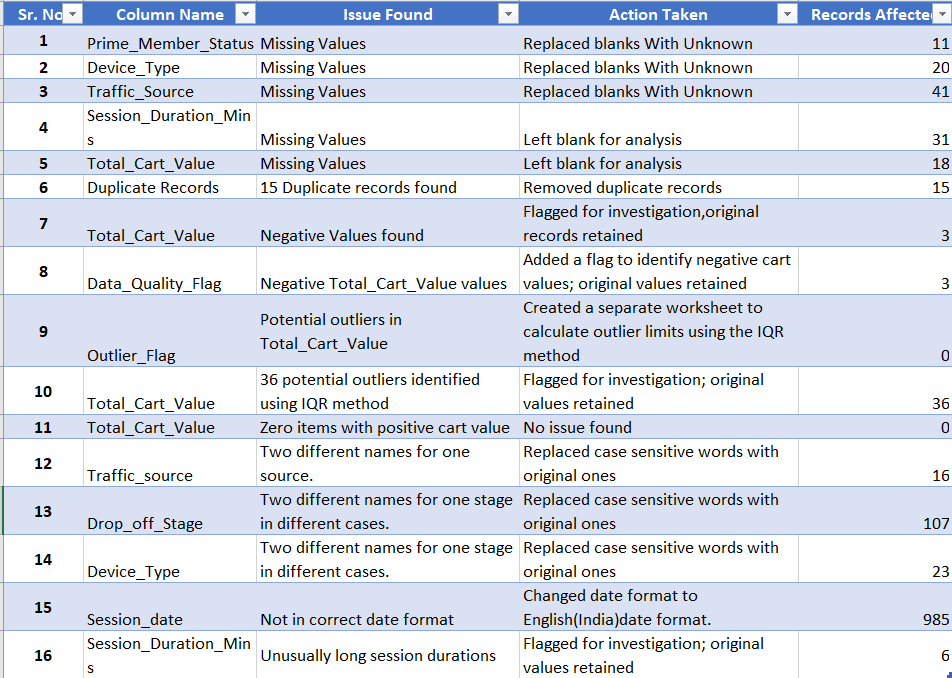
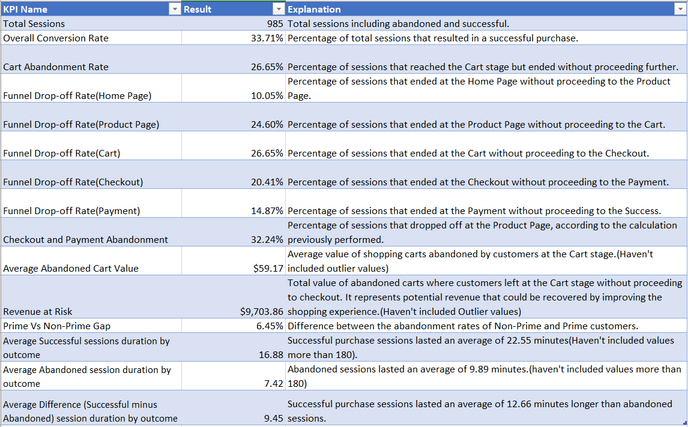
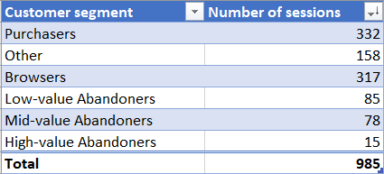
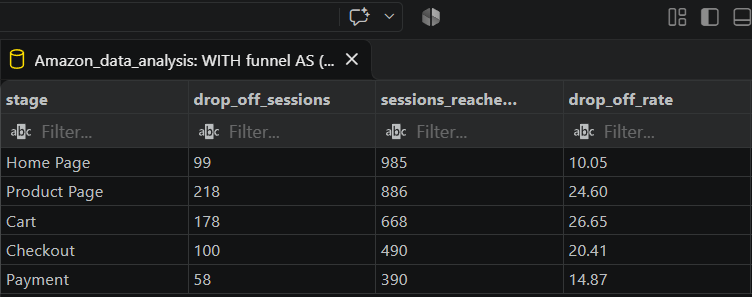
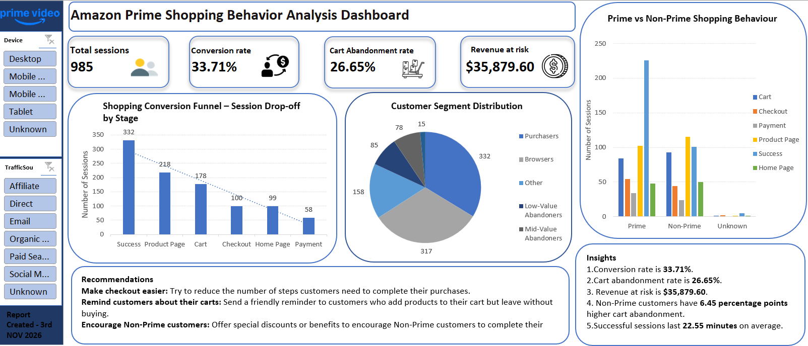

# 📊 AMAZON SHOPPING BEHAVIOUR ANALYSIS PROJECT

## 📌 1. Project Overview

The Shopping Behaviour Analysis project focuses on understanding customer shopping patterns and identifying reasons for cart abandonment.

The project uses a simulated Amazon shopping behaviour dataset and analyses it using Microsoft Excel and PostgreSQL. The main objective is to understand customer purchasing behaviour, calculate important business KPIs, identify potential revenue at risk and suggest improvements to increase purchase completion.

## 🎯 2. Project Objectives

* Analyse customer shopping behaviour on Amazon.
* Identify cart abandonment patterns.
* Calculate conversion and abandonment rates.
* Identify potential revenue at risk.
* Divide customers into different segments.
* Compare Prime and Non-Prime customer behaviour.
* Create an interactive Excel dashboard.
* Provide recommendations to improve the shopping experience.

## 📂 3. Dataset Description

The project uses a Amazon shopping behaviour dataset containing 1,000 original records.

The dataset includes information about customer sessions, shopping activity, cart values and purchase stages.

Important columns include:

* Session ID
* User ID
* Session Date
* Prime Member Status
* Device Type
* Traffic Source
* Session Duration
* Items in Cart
* Total Cart Value
* Drop-off Stage

After 3 columns were added
* Customer Segment
* Data quality flag
* Outlier analysis

After removing 15 duplicate records, 985 records remained for further analysis.

## 📊 4. Project folder structure
```
Amazon_Data_Analysis/
│
├── 01_Data/
│  ├── 01_Raw_data/
│  │        ├──Amazon_Prime_Cart_Abandonment_PRD.docx
│  │        └──prime_cart_sessions.csv
│  └── 02_Cleaned_data/
│            └──prime_cart_sessions_cleaned.csv
│
├── 02_Excel_workbook/
│   └──prime_cart_sessions_cleaned.xlsx
│
├── 03_SQL_analysis/
│      ├──01_Create_table_sql
│      └──02_Reconcil_KPIs.sql
│
├──04_Report/
│   └──Amazon_prime_data_analysis.pdf
│
└──  README.md
```

## 🛠 5. Tools and Technologies Used

### Microsoft Excel

Used for:

* Data cleaning and formatting.
* Handling missing values.
* Removing duplicate records.
* Identifying outliers.
* Calculating KPIs.
* Customer segmentation.
* Creating an interactive dashboard.

### PostgreSQL

Used for:

* Importing the cleaned dataset.
* Writing SQL queries.
* Calculating business metrics.
* Analysing shopping behaviour.
* Comparing customer groups.
* Verifying Excel results.

## 📁 6. Data Cleaning and Preparation

Before analysis, the dataset was checked and cleaned.



The following activities were performed:

1. Removed 15 duplicate records.
2. Identified and handled missing values.
3. Standardised inconsistent text values in Traffic Source, Device Type and Drop-off Stage.
4. Checked date and numerical formatting.
5. Identified 36 potential cart value outliers using the IQR method.
6. Identified three records containing negative cart values.
7. Flagged six sessions with unusually long durations for investigation.
8. Prepared the cleaned dataset for further analysis.

The original values of unusual records were retained for investigation rather than being changed without verification.

## 💻 7. Key Performance Indicators (KPIs)

The following KPIs were calculated during the analysis:

| KPI                                   |        Result |
| ------------------------------------- | ------------: |
| Total Shopping Sessions               |           985 |
| Completed Purchases                   |           332 |
| Conversion Rate                       |        33.71% |
| Cart Abandonment Rate                 |        26.65% |
| Checkout and Payment Abandonment Rate |        32.24% |
| Average Abandoned Cart Value          |        208.60 |
| Potential Revenue at Risk             |     35,879.60 |
| Average Successful Session Duration   | 22.55 minutes |
| Average Abandoned Session Duration    |  9.89 minutes |

These KPIs helped understand customer behaviour and identify areas that may need improvement.



## 👥 8. Customer Segmentation

Customers were divided into five segments based on their shopping activity:

1. Browsers
2. Purchasers
3. Low-Value Abandoners
4. Mid-Value Abandoners
5. High-Value Abandoners
6. Others

This segmentation helped understand different customer groups and their purchasing patterns.



## 🗄 9. SQL Analysis

PostgreSQL was used to re-analyse the cleaned Amazon shopping behaviour dataset and extract meaningful business insights.

The SQL analysis included:

* Calculating total shopping sessions and completed purchases.
* Calculating conversion and cart abandonment rates.
* Analysing shopping funnel drop-offs.
* Identifying potential revenue at risk.
* Comparing Prime and Non-Prime customer behaviour.
* Analysing customer segments.
* Checking and validating KPI results against Excel calculations.





## 📈 10. Dashboard Description

An interactive Excel dashboard was created to present the analysis results.
The dashboard includes:

* Total Shopping Sessions.
* Conversion Rate.
* Cart Abandonment Rate.
* Revenue at Risk.
* Average Abandoned Cart Value.
* Shopping Conversion Funnel.
* Customer Segment Breakdown.
* Prime vs Non-Prime Shopping Behaviour.

Interactive slicers were added for Prime Member Status, Device Type and Traffic Source.


## 💡 11. Key Findings

The analysis revealed the following findings:

* The overall conversion rate was 33.71%.
* The cart abandonment rate was 26.65%.
* Abandoned carts represented 35,879.60 in potential revenue at risk.
* Successful shopping sessions lasted longer on average than abandoned sessions.
* Non-Prime customers showed a higher cart abandonment rate than Prime customers.

These findings helped identify opportunities to improve customer purchasing behaviour.

## 🎯 12. Recommendations

Based on the analysis, the following recommendations were suggested:

1. Simplify the checkout process to make purchasing easier.
2. Send reminders to customers who abandon their carts.
3. Provide special offers or benefits to Non-Prime customers.
4. Offer Cash on Delivery (COD) for different purchase values, with suitable verification and order limits, to build customer trust and encourage purchases.

## 13. Challenges Faced

During the project, some challenges included handling missing values, removing duplicate records, standardising inconsistent text values and identifying unusual cart values and session durations.

Writing SQL queries, matching SQL results with Excel calculations and creating an organised interactive dashboard also required careful attention.

Working through these challenges improved my practical understanding of data cleaning, Excel, SQL and data analysis.

## 14. Conclusion

This project provided practical experience in analysing shopping behaviour using Excel and PostgreSQL.

It helped identify cart abandonment patterns, understand customer segments and estimate potential revenue at risk. The interactive dashboard presented the findings clearly and helped generate recommendations for improving the shopping experience.

Overall, the project strengthened my skills in data cleaning, SQL querying, KPI calculation, data analysis and dashboard creation.

---

## 15. Project Files

The project folder contains the following files:

* Original Dataset (Originally in xlxs file, converted in CSV for sql queries)
* Cleaned Dataset (CSV)
* Excel Analysis Workbook (XLSX)
* PostgreSQL SQL Queries (SQL)
* Shopping Behaviour Dashboard
* Internship Project Report (PDF/DOCX)
* README.md

## 16. Author's Note

Mahi Choudhary

This project was completed as part of my internship to gain practical experience in data analytics. Working on this project helped me improve my skills in Microsoft Excel, PostgreSQL, data cleaning, data analysis and dashboard creation.

It was a valuable learning experience that helped me understand how data can be used to identify business problems and support better decision-making.

